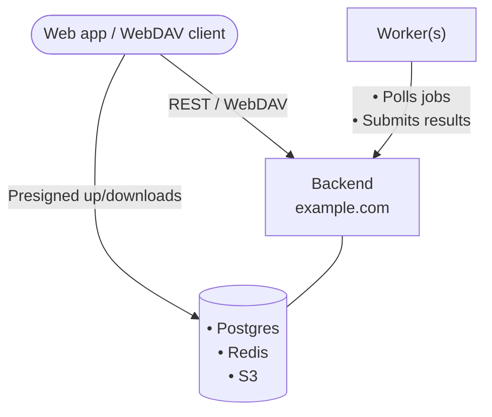
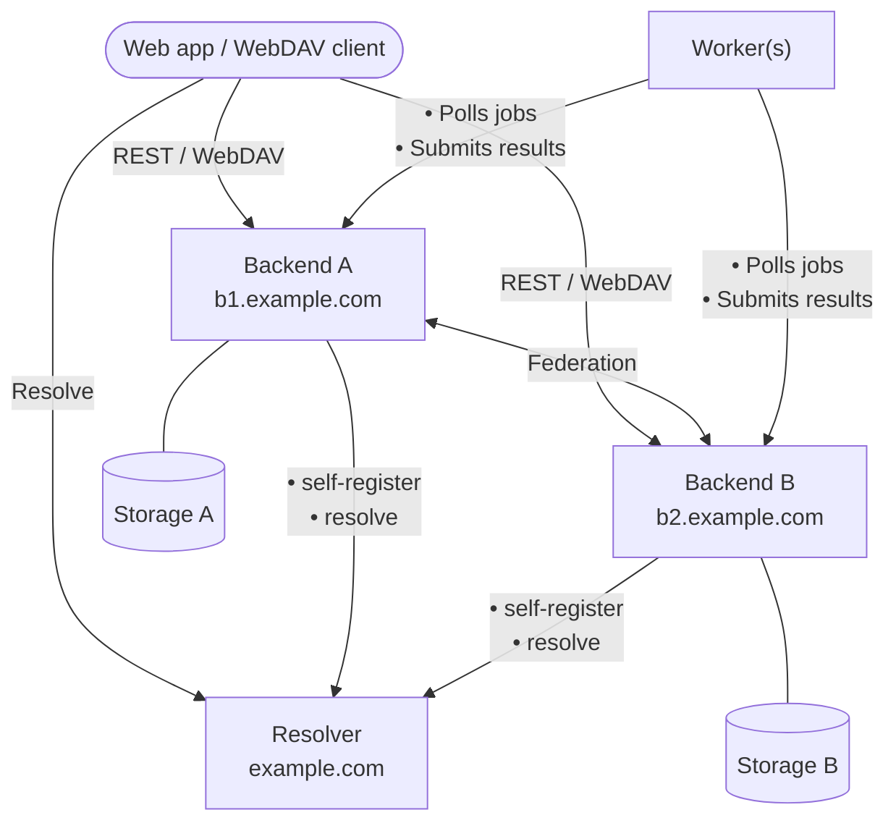

<p align="center">
  <picture>
    <source media="(prefers-color-scheme: dark)" srcset="logo/logo-dark.svg">
    <source media="(prefers-color-scheme: light)" srcset="logo/logo-light.svg">
    
  </picture>
</p>

<p align="center">
  <strong>Federated, self-hostable photo library</strong> — tag-based organization, cross-instance sharing, and WebDAV-exposed tag hierarchies.
</p>

<p align="center">
  <a href="https://github.com/ClementGre/Archypix/blob/main/LICENSE"></a>
  <a href="https://github.com/ClementGre/Archypix/actions/workflows/ci.yml"></a>
  
  <a href="https://github.com/ClementGre/Archypix/stargazers"></a>
</p>

<p align="center">
  <a href="#overview">Overview</a> •
  <a href="#features">Features</a> •
  <a href="#architecture">Architecture</a> •
  <a href="#self-hosting">Self-Hosting</a> •
  <a href="#development">Development</a> •
  <a href="#the-story-of-archypix">Story</a> •
  <a href="#license">License</a>
</p>

---

## Overview

Archypix is a self-hosted, federated photo library. It gives you full ownership of your media while letting you share with users on other
instances, without any central authority.

Instead of albums, Archypix organizes everything around **tags**: hierarchical labels such as `/Photos/Travel/Alps`, assigned by hand or by
automated rules. Your tags can be browsed in the web app, or turned into virtual folder trees ("hierarchies") that you mount with any WebDAV
client or OS file manager — moving a file between folders re-tags the picture.

Users are identified as `@username:domain`, like an email address. Any instance can share with any other: the owner's backend is found with a
single `/archypix-resolver/resolve` lookup on the user's domain. One domain can be served by a single backend, or by several backends behind a
lightweight Resolver service.

> **Status:** under active development (pre-1.0, tagged releases `0.1.x`). The core features below work today; expect breaking changes between
> versions. The full specification is in [doc/01_GENERAL_SPECIFICATIONS.md](doc/01_GENERAL_SPECIFICATIONS.md).

## Features

### Tags

Hierarchical paths (`/Photos/Travel/Alps`), set by hand or by rules. A tag implies its parents.

- Display names, colours, covers and custom ordering.
- Renaming a tag updates every picture, share, rule and hierarchy that uses it.
- **Sensitive** tags blur or hide their pictures until revealed.
- Trash with configurable retention.

### Automatic tagging

A pipeline of services that re-tags only the affected pictures on every upload, edit or received share.

- **Rules**: AND/OR/NOT conditions on date, GPS zone, camera, file and more.
- **Calendar segmentation**: one date tag per picture (year, season, month…), with custom periods on top.
- **Shared-tag mappings**: file received pictures into your own tags.

### Browsing and editing

Built to browse, not just list files: responsive grid, lightbox, mobile layout.

- **Timeline view**: any tag, grouped by date, with its subtags as expandable blocks.
- **Filters**: pictures missing GPS or a date, pictures nearest to another in time or place.
- **Metadata editing**, written back into the file itself (EXIF, HEIC orientation).
- **Batch editing** of tags, metadata and trash, with a dry-run preview.
- **Photo fix tools**: guided GPS and date fixing, with suggestions and interpolation.
- Inline video playback.

### Hierarchies and WebDAV

Virtual folder trees built from your tags, mountable in any WebDAV client or file manager.

- Mirror tag subtrees, add query folders, collapse or exclude branches, use drop folders as tagging inboxes.
- Uploads, moves and deletes become tag changes; a safe-delete mode protects against overzealous sync clients.

### Sharing

Federated: every instance is a peer, no central server required.

- Share a tag with any `@user:domain`; files stay on the owner's server.
- New pictures are sent automatically; shares can be re-shared, shared back, and revoked anytime.
- Recipients are warned before the owner deletes a picture, and duplicates across shares show once.
- Recipients can override metadata for themselves or, if allowed, propose fixes to the owner.
- A **creator** credit, distinct from the owner, follows pictures across shares.
- **Public links**: view-only or full-quality, with optional anonymous contributions.

### Storage and administration

- Any S3-compatible store, with direct browser uploads/downloads and dedup at upload.
- Per-user versioning (original or every version) and storage quotas.
- Open, invite-only or admin-invite registration.
- Admin dashboard, plus a fleet dashboard for multi-backend deployments.
- OpenTelemetry tracing.

### Roadmap

Not yet implemented, full detail in [doc/99_ROADMAP.md](doc/99_ROADMAP.md):

- **ML workers** — style, people and location-grouping inference.
- **Onboarding & opinionated defaults** — a fresh account organizes itself out of the box.
- **Bulk library import** — Google Takeout and local folders.
- **External shared-album import** — one-time import from Google Photos and iCloud shared albums.
- **PWA & mobile** — a mobile-friendly PWA, then a native iOS background uploader.
- **Backup & recovery** — object replication, Postgres point-in-time recovery.
- **Managed hosting** — a fully-managed `archypix.com` offering.
- **Versions UI** — browsing and restoring previous versions of a picture.
- **Metadata edit history** — a per-picture revision log for review and undo.
- **Advanced WebDAV** — directory-level move/copy, real locking, hiding sensitive pictures.
- **Visual picture editing** — crop, brightness/contrast, resize.
- **Video transcoding & HLS** — adaptive streaming beyond today's direct playback.
- **Time zones & GPX import** — know each photo's capture time zone, and geotag photos from a recorded GPS track.

## Architecture

Single backend:



Several backends behind one domain:



Instances on different domains federate the same way backends A and B do.

| Component                                                                 | Role                                                                                                                                                                                                |
|---------------------------------------------------------------------------|-----------------------------------------------------------------------------------------------------------------------------------------------------------------------------------------------------|
| [**Backend**](https://github.com/ClementGre/Archypix/tree/main/back)      | Rust (Axum) server. Authoritative for its users' pictures, tags, shares and settings. Serves the REST API and WebDAV, runs the tagging pipeline and background routines, and owns the job queue. |
| [**Worker**](https://github.com/ClementGre/Archypix/tree/main/worker)     | Stateless Rust process polling backends for jobs: thumbnails, metadata extraction, BlurHash, file hashing (images and videos), and writing metadata edits into files. Never touches the database.   |
| [**Resolver**](https://github.com/ClementGre/Archypix/tree/main/resolver) | Optional. Maps `@username:domain` to the backend that owns the user, places new registrations on a backend (least-loaded, round-robin…), and serves the fleet admin dashboard.                     |
| [**Frontend**](https://github.com/ClementGre/Archypix/tree/main/front)    | Static React single-page app. Finds the user's backend through the resolution endpoint, then talks to it directly, so one frontend can serve users of any instance that allows it in CORS. |

A lone backend answers the resolution endpoints itself, so the Resolver is only needed once you run more than one backend behind the same domain.

## Self-Hosting

Archypix is deployed with Docker Compose, using the images CI publishes to `ghcr.io/clementgre/archypix-{back,worker,resolver,front}`. Every
instance needs Postgres, Redis and an S3-compatible object store, plus a reverse proxy for TLS and routing (Traefik in the examples).

Postgres must have the [pgvector](https://github.com/pgvector/pgvector) extension: the composes use `pgvector/pgvector:0.8.2-pg18-trixie`
(`postgres:18-trixie` + pgvector). An existing `postgres:18`/`18-trixie` server can swap to it and restart; one coming from `postgres:18-alpine`
must run `REINDEX DATABASE <db>;` once per database (the text collation changes from musl to glibc).

### Single backend (recommended)

The simplest setup, and the right starting point for almost everyone: [`docker-compose.yml`](docker-compose.yml) at the repo root bundles
Postgres, Redis, MinIO, one backend, one worker and the frontend into a single stack. No Resolver is needed.

It expects an existing Traefik reverse proxy on an external `traefik` Docker network, and four DNS records pointing at your host:

| Variable        | Serves                                                                                                                                                                                                  |
|-----------------|---------------------------------------------------------------------------------------------------------------------------------------------------------------------------------------------------------|
| `GLOBAL_DOMAIN` | Your identity domain: users are `@username:GLOBAL_DOMAIN`. Only the `/archypix-resolver` path is forwarded to the backend, so the rest of the domain stays free for a website.                          |
| `FRONT_DOMAIN`  | The web app.                                                                                                                                                                                            |
| `BACK_DOMAIN`   | The backend API and WebDAV. Can equal `GLOBAL_DOMAIN`, but a separate subdomain keeps your identity domain clean.                                                                                       |
| `S3_DOMAIN`     | MinIO. Browsers upload and download files directly from object storage, so it must be publicly reachable.                                                                                              |

```bash
git clone https://github.com/ClementGre/Archypix.git
cd Archypix
cp .env.example .env   # fill in domains, passwords and secrets
docker compose up -d
```

Set `TAG` in `.env` to a release (e.g. `0.1.3`) rather than `main` for reproducible deployments. To use an external S3 provider instead of the
bundled MinIO, follow the comments on the `minio` service in `docker-compose.yml`.

**Using the hosted web app instead of your own:** remove the `front` service and add `https://archypix.com` to `CORS_ORIGINS`. On the login
page at [archypix.com](https://archypix.com), click the instance next to your username and enter your `GLOBAL_DOMAIN`.

See [`.env.example`](.env.example) for every variable, and [doc/02_INFRASTRUCTURE_DESIGN.md](doc/02_INFRASTRUCTURE_DESIGN.md) for what each
component does.

### Multiple backends behind one domain

Once a single backend's resources become the limit, put a Resolver in front of several backends sharing one public domain
(`@user:example.com` resolves to whichever backend owns that user). [`docker/docker-compose.prod.yml`](docker/docker-compose.prod.yml) is the
`archypix.com` deployment and a worked example of this topology: a resolver, two backends, a shared worker and a frontend behind Traefik, with
external Postgres/Redis/Traefik networks and per-backend MinIO buckets. Adapt its environment variables and Traefik labels to your own domains
and secrets.

## Development

[`docker/docker-compose.dev.yml`](docker/docker-compose.dev.yml) runs a local federation from source: a resolver with two backends on
`archypix.test`, a standalone third backend on `solo.archypix.test`, workers, Postgres, Redis, MinIO and Jaeger. Add the
[`docker/hosts`](docker/hosts) entries to `/etc/hosts`, then:

```bash
docker compose -f docker/docker-compose.dev.yml up --build
```

Run the frontend with `pnpm install && pnpm dev` in [`front/`](front) (its `.env.example` targets `archypix.test`). A Nix flake provides the
toolchain (`nix develop`).

The [`doc/`](doc) folder holds the specification (`01`), the infrastructure (`02`) and per-component architecture docs (`03`–`07`, including the
full API reference), the roadmap (`99`), and one design document per feature in [`doc/features/`](doc/features).

## The Story of Archypix

### December 2022 — PicturesManager

The project started as [**PicturesManager**](https://github.com/ClementGre/PicturesManager), a desktop photo manager built
with [Tauri](https://tauri.app/). The stack was unusual by choice: a Rust backend coupled with a Rust [WebAssembly](https://webassembly.org/) frontend
written in [Yew](https://yew.rs/), fast, safe, and entirely in one language. The core idea was already there: automatic grouping rules to organize
pictures without manual effort.

### March 2024 — PMCloud

[**PMCloud**](https://github.com/ClementGre/PMCloud) moved the project to the cloud. The desktop shell was dropped in favor of
a [Vue.js](https://vuejs.org/) web frontend backed by a [Rocket](https://rocket.rs/) API and [Diesel](https://diesel.rs/) ORM. The signature feature
of this iteration was shared groups: multiple users could collaborate on the same event's pictures while each keeping their own automatic grouping
rules applied on top.

### January 2025 — Archypix (first generation)

The project was rebranded as **Archypix** — *Archy* for the structured, architectural way it lets you organize your library, *pix* for pictures. The
technology stack was carried forward and the codebase underwent a major
refactoring ([back](https://github.com/ClementGre/old-archypix-app-back) / [front](https://github.com/ClementGre/old-archypix-app-front)), laying
groundwork for the ambitions of the next phase.

### January 2026 — Archypix (current, from scratch)

Development restarted from a blank slate with an entirely new specification and a new stack: Rust ([Axum](https://github.com/tokio-rs/axum),
[SQLx](https://github.com/launchbadge/sqlx)) on the server and [React](https://react.dev/) on the client. The central breakthrough: Archypix became
**decentralized**. Instances are peers — any instance can share with any other, world-wide, without a central registry. A single public domain can
host multiple backend instances for scaling or migration, and completely independent domains federate natively. The tagging model was redesigned
around hierarchical paths and automated pipelines, and hierarchies were introduced as the primary way to browse and sync the library.

This is the Archypix we are building today, and there is a lot left to implement. Contributions and ideas are very welcome.

## License

Archypix is released under the [GNU Affero General Public License v3.0](https://github.com/ClementGre/Archypix/blob/main/LICENSE).

In short: you are free to use, modify, and distribute Archypix, but any modified version you run as a network service must also be made available
under the same license.
